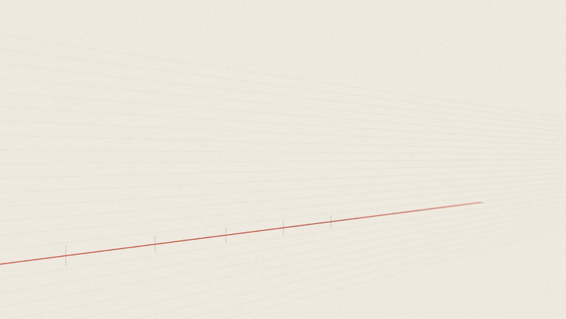
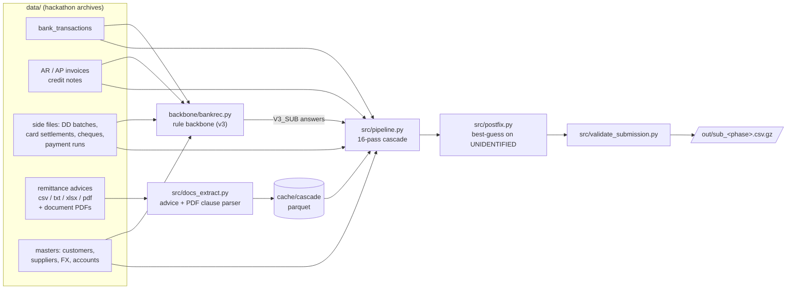
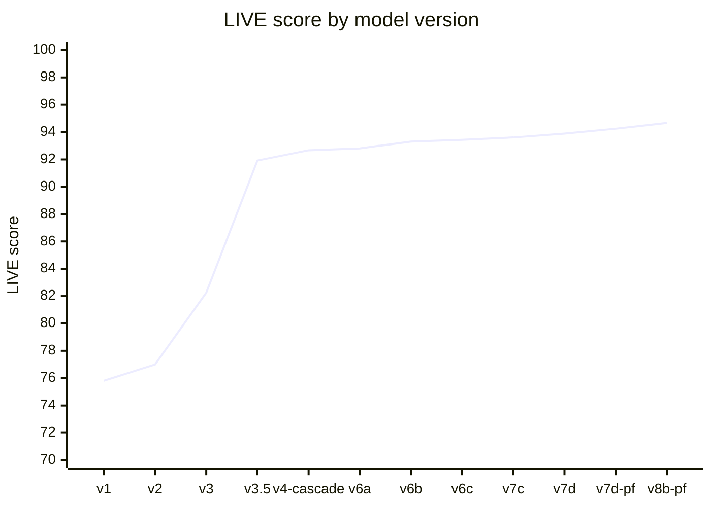

<div align="center">

# Saturn Return

**Bank reconciliation at scale: explain every bank line of a 17-company group, from invoice match to exception code.**

[](https://www.python.org/)
[](https://pandas.pydata.org/)
[](https://arrow.apache.org/)
[](https://pymupdf.readthedocs.io/)
[-95.06-c0392b)](#results)
[](docs/RESULTS.md)
[](LICENSE)
[](#team)

</div>

## Demo

<p align="center">
  <a href="https://github.com/jorgecarnicero/talky-x-claude/raw/main/docs/assets/demo.mp4">
    
  </a>
  <br>
  <sub>▶ <a href="https://github.com/jorgecarnicero/talky-x-claude/raw/main/docs/assets/demo.mp4"><b>Watch the full film with sound</b></a> (MP4, 1280×720)</sub>
</p>

## Overview

Every morning a group treasury receives thousands of bank movements and must say, for each one, **which open invoices
or credit notes it settles and by how much**, or, if it settles none, **what it is** (bank fee, payroll, cash-pooling
sweep, tax…). On top of that it must flag the **exception**: partial payment, early-payment discount, bank charges,
withholding, FX difference, return, duplicate, unidentified receipt.

This repo is our entry to a bank-reconciliation hackathon run on a synthetic but realistically calibrated group:
17 companies in 15 countries, 12 currencies, 13 banks and about 50 accounts. The data covers four years of labelled
TRAIN history (2021-07 → 2025-06), a six-month LIVE phase with a public leaderboard (~203,000 bank lines) and a
six-month FINAL phase scored once, blind. The data drifts on purpose: a bank migrates from Norma 43 to camt.053, a large
customer changes its remittance format, and FINAL adds a newly acquired South African subsidiary with a bank format
never seen before.

Scoring:

```
score = 100 × (0.5 · allocation F1  +  0.3 · per-line accuracy  +  0.2 · exception macro-F1)
```

### Why this approach

- **Deterministic, explainable passes instead of a single model.** Each pass encodes one settlement pattern with
  evidence a treasurer would accept (a batch file, a remittance advice, a cited invoice number, a PDF clause). Every
  output row records which pass produced it, so errors can be traced to a rule.
- **First claim wins.** Precise evidence runs first. Fuzzier passes only see what is still unexplained, so a new pass
  cannot damage lines that are already right.
- **No labels at inference.** Passes use the open-item ledger and the documents, not the golden allocations. Labels are
  used only for evaluation and for one small category classifier on non-invoice lines.
- **Overfitting treated as a real risk.** With one blind FINAL shot, a candidate change had to pass pre-registered
  gates on held-out TRAIN windows before it reached LIVE (see [docs/ANTI_OVERFIT.md](docs/ANTI_OVERFIT.md)).

## Architecture



The cascade (`src/pipeline.py`) runs passes in a fixed order over a shared ledger of open items. A bank line claimed by
one pass is never touched again. Whatever survives every pass gets a fallback (receipt → `UNIDENTIFIED`,
payment → `BANK_FEES`).

| # | Pass | What it resolves |
|---|---|---|
| 1 | `batches` | Lines whose content is listed in a side file: SEPA direct-debit batches and their returns, card settlements, cheque deposits, payment runs |
| 2 | `remittance` | Receipts matched through parsed remittance advices |
| 3 | `ap_match` | Supplier-side lines outside payment runs: supplier direct debits, refunds, rejected transfers |
| 4 | `nonitem` | Lines that settle no item: bank reversals, fees, payroll, taxes, cash pooling → category |
| 5 | `ar_multi` | Receipts that net return credit notes against the invoices they reference |
| 6 | `ar_pdf` | Receipts explained by a clause of the invoice PDF (instalment *k of n*, retention, withholding) |
| 7 | `v3import_strong` | Backbone answers backed by strong evidence (cited reference, single exact amount) |
| 8 | `ar_match` | Main AR matcher: identify the payer (IBAN / name / payer directory), parse references, explain the amount over that customer's open items (subset search, discounts, FX, n-to-m) |
| 9 | `ar_multi_late` | n-to-m receipts: several invoices paid in full plus one paid partly |
| 10 | `ar_bigpool` | Identified customer with a large open pool paying a batch without references (bounded subset solver) |
| 11 | `ar_dispute` | Receipts short by a withholding or a dispute deduction |
| 12 | `ar_guess` | Calibrated best guess for receipts still unmatched (allocation F1 rewards guesses that are right more than about 47 % of the time) |
| 13–14 | `v3import`, `v3rest` | Remaining backbone answers for anything still unclaimed |
| 15 | `exc_fix` | Replays all answers chronologically over the opening ledger and re-derives exception codes and amounts |
| 16 | `cancel_guard` | Removes invoice and credit-note pairs that cancel each other and are never settled by bank |

`postfix.py` then revisits receipts left `UNIDENTIFIED` and, when the payer is identified, assigns the most likely
invoice subset within a 130-day window.

## Results

**FINAL (blind, one submission): 95.06.** On FINAL, six months the team had never seen, with a newly acquired subsidiary
and a new bank format, the method scored higher than on LIVE (94.67), where it was developed.

LIVE leaderboard score for each model the team froze and submitted (the full table with per-component metrics is in
[docs/RESULTS.md](docs/RESULTS.md)):



| | Starter baseline | v3 (rule backbone alone) | **Final method (v8b-pf / v8d)** |
|---|---:|---:|---:|
| **FINAL score (blind)** | – | – | **95.06** |
| **LIVE score** | 11.28 ¹ | 82.25 | **94.67** |
| Allocation F1 (precision / recall) | – | 85.4 % (98.3 / 75.4) | **95.2 % (96.1 / 94.3)** |
| Per-line accuracy | – | 87.4 % | **96.6 %** |
| Exception macro-F1 | – | 66.8 % | **90.4 %** |

<sub>¹ Organizer baseline, scored on the sample month.</sub>

What moved the score:

- **+9.7 points, v3 → v3.5:** high-precision passes (batches, remittances, AP, non-item) ahead of the backbone, plus a
  dedicated AR matcher on the receipts v3 left unidentified. Allocation recall rose from 75 % to 90 %.
- **Exceptions, 66.8 % → 90.4 % macro-F1:** `exc_fix` re-derives exceptions from a chronological replay of the ledger
  instead of trusting the pass that matched the line. Typical gains: dispute settlements 89 → 98.5 %, overpayments
  56 → 76 %.
- **+0.28 points from pass order alone (v7c → v7d):** running our matchers before the backbone's weaker answers.
- **+0.78 points from calibrated guessing (v7d 93.89 → v8b-pf 94.67):** allocation F1 is computed over (line, invoice)
  pairs, so a guess right more than about 47 % of the time is worth making. `ar_guess` and `postfix` only guess for
  identified payers.

Engineering trade-offs:

- **Runtime vs. evidence:** a full LIVE or FINAL run takes about 25 minutes with peak memory around 7 GB. PDF and advice
  parsing is the expensive part, so it runs once per phase and is cached to parquet.
- **Drift readiness for a blind shot:** `tools/shift_report.py` compares a new phase with the reference before
  submitting. On FINAL it flagged the new South African bank, whose `EFT CREDIT <name>` format then got its own
  payer pattern (payer extraction on that bank: 15 % → 99.6 %).
- **A bug caught on FINAL day:** card order numbers repeat across entities in FINAL. Keying the card-order cache by
  (order, entity) halved the false `DUPLICATE_PAYMENT` rows (1,526 → 763) in the submitted file.

The submitted FINAL file (scored 95.06) is archived in [submissions/](submissions/): 220,256 rows, valid, with 4.9 % of
receipts left `UNIDENTIFIED`.

## Project structure

```
.
├── backbone/
│   └── bankrec.py            rule backbone (v3): batches, returns, advices, references, payer + amount, category model
├── src/
│   ├── pipeline.py           cascade entry point: runs the passes in order, writes the submission
│   ├── passes/               one module per pass, each exposing run(ctx)
│   ├── data.py               data loading, open-item ledger, shared context, parquet caching
│   ├── docs_extract.py       remittance-advice and document-PDF extraction → parquet
│   ├── docs_clauses.py       PDF clause parsing (instalments, retention, withholding)
│   ├── ar_index.py           AR item indexes      payer_dir.py   payer directory (IBAN / alias history)
│   ├── bigpool_solver.py     bounded subset solver used by ar_bigpool / ar_guess
│   ├── postfix.py            best-guess post-processor for UNIDENTIFIED receipts
│   ├── evaluate.py           score a submission on a TRAIN window with the official scorer
│   └── validate_submission.py
├── tools/
│   ├── make_dev_dataset.py   carve a LIVE-shaped dev phase out of TRAIN (needs duckdb)
│   ├── significance.py       acceptance gates: McNemar, payer sign test, month / entity balance
│   ├── shift_report.py       drift report between two phases
│   ├── score_dev.py  rowloss.py  diagnose.py  validate.py
├── scripts/
│   └── run.sh                one command: backbone → docs → cascade → postfix → validate
├── docs/
│   ├── RESULTS.md            score log for every submitted model
│   ├── ANTI_OVERFIT.md       acceptance method and its sources (Spanish)
│   ├── V35.md  V4.md  ROADMAP.md   design notes per stage
│   └── assets/               demo film (MP4) and its looping preview (GIF)
├── submissions/              the FINAL file that was submitted
├── requirements.txt          pinned runtime dependencies
├── LICENSE                   MIT
└── pyproject.toml
```

Not committed: `data/` (hackathon archives), `cache/` (parquet caches), `out/` (run outputs).

## Quickstart

**Requirements:** Python 3.11+, poppler's `pdftotext` on `PATH` (macOS `brew install poppler`, Debian/Ubuntu
`apt install poppler-utils`; Git Bash on Windows already includes it), about 8 GB of free RAM for a full phase.

```bash
# 1. Clone and install
git clone https://github.com/jorgecarnicero/talky-x-claude.git
cd talky-x-claude
python3 -m venv .venv
source .venv/bin/activate          # Windows (Git Bash): source .venv/Scripts/activate
pip install -r requirements.txt

# 2. Put the hackathon archives in data/ (they are not redistributed here)
mkdir -p data
unzip bankrec-docs-and-masters.zip -d data      # masters/, sample/, starter/ (official scorer), policies
tar -xzf bankrec-train-lite.tar.gz -C data      # train/
tar -xzf bankrec-live.tar.gz      -C data       # live/
# FINAL, when available: extract so that data/final/bank_transactions.csv.gz exists

# 3. Run
bash scripts/run.sh sample        # smoke test on one labelled month (~25 min: exc_fix replays the TRAIN ledger)
bash scripts/run.sh live          # full LIVE phase, ~25 min → out/sub_live.csv.gz
bash scripts/run.sh final         # FINAL phase → out/sub_final.csv.gz
```

Running a single stage or a subset of passes:

```bash
# cascade on a TRAIN window, only some passes, then score it with the official scorer
python src/pipeline.py --phase train --from 2025-04-01 --to 2025-05-31 --passes batches,remittance,nonitem --out out/dev.csv.gz
python src/evaluate.py out/dev.csv.gz --phase train --from 2025-04-01 --to 2025-05-31

# backbone alone on the held-out dev months, with per-line reasons and per-segment scores
python backbone/bankrec.py --phase dev --out out/sub_dev.csv.gz --why out/why_dev.csv
python tools/score_dev.py out/sub_dev.csv.gz
```

Environment variables: `BANKREC_DATA` (data root, default `./data`), `BANKREC_CACHE` (parquet cache, default
`./cache/cascade`), `PY` (interpreter for `run.sh`), `OUT` (output folder, default `./out`). Most passes also expose
their thresholds as environment variables (for example `BP_KMAX`, `DISP_MAX_POOL`); see the top of each module.

## Development history

Every submitted model is kept as a git tag (`v2`, `v3`, `v3.5`, `v4-cascade`, `v6a` … `v8b-pf`, `v8d-final`), each with
its LIVE score in the tag message. `git tag -n1` lists them, and `git checkout <tag>` restores the exact code behind any
row of [docs/RESULTS.md](docs/RESULTS.md).

## Team

Built during the Talky × Anthropic bank-reconciliation hackathon (November 2026) by **Jorge Carnicero**
([@jorgecarnicero](https://github.com/jorgecarnicero)), **Aryan Verma** ([@aryanv175](https://github.com/aryanv175)),
**Mateo** ([@automatizamateo](https://github.com/automatizamateo)) and **Alejandro**
([@alejandropastor03](https://github.com/alejandropastor03)), with Claude as a pair programmer throughout.

All data is synthetic and belongs to the event organizers. It is not included in this repository.

## License

[MIT](LICENSE). The license covers the code in this repository, not the hackathon data.
